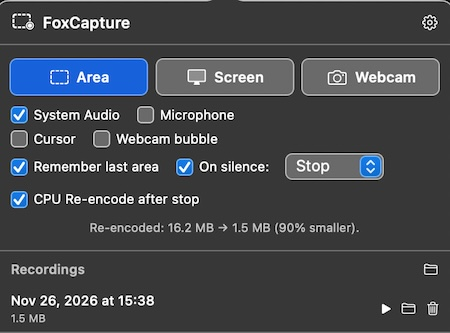
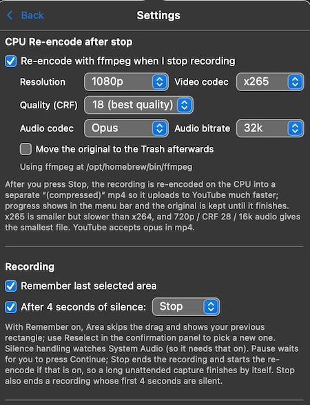

# FoxCapture

Screen recorder that lives in your macOS menu bar: drag to select an area, or
grab the whole screen, and it records straight to MP4. Native SwiftUI, no
Electron, no cloud. 

Built on the same principles as [ClipboardFox](https://github.com/libracoder/clipboardfox) a plain Swift package, a tiny menu bar app, everything stays on your machine.

This is a fork of the orginal [FoxCapture](https://github.com/libracoder/foxcapture) adding additional features like remember last area, auto-pause on silence and fixing a few bugs.



## Features

- **Area recording**: click Record Area, drag a rectangle on any screen,
  recording starts the moment you release — Esc cancels
- **Full-screen recording**: records the screen your pointer is on
- **Straight to MP4** via ScreenCaptureKit's recording output (H.264 or HEVC,
  30 or 60 fps) — by default there is no re-encoding step, the file is ready
  when you stop
- **CPU Re-encode after stop** (optional, needs [ffmpeg](https://ffmpeg.org)):
  shrinks the recording for a much faster YouTube upload. Pick the resolution
  (original / 1080p / 720p, never upscaled), video codec (x265 / x264), CRF
  (28 smaller / 23 better / 18 best quality), audio codec (Opus / AAC) and audio bitrate
  (16k / 32k / 192k). The result is saved next to the original as
  `… (compressed).mp4`; the percentage shows in the menu bar while it runs and
  the popover has a Cancel button. The original is kept unless you tick
  "Move the original to the Trash afterwards". Recording is blocked while
  encoding so x265 can't make the next capture drop frames
- **System audio and microphone** can be muxed into the video, both optional



- **Remember last area** (optional): Area reuses your previous rectangle —
  confirm it, or hit Reselect to drag a new one
- **On silence: Pause or Stop** (optional): after 4 seconds without system
  audio it pauses (press Continue to resume) or stops, so a long unattended
  capture can finish and re-encode by itself
- **Menu bar control**: elapsed time in the bar; click the icon to stop
- **History**: recent recordings in the popover with play / reveal / delete;
  files are plain timestamped mp4s in `~/Movies/FoxCapture` (configurable)

## Build

```sh
./build.sh
open build/FoxCapture.app
```

Requires macOS 15+ and Xcode command line tools. CPU Re-encode additionally
needs ffmpeg with libx265, libx264 and libopus (`brew install ffmpeg`); it is
looked for in the app bundle, Homebrew, MacPorts and your PATH.

## Permissions

- **Screen Recording** (System Settings → Privacy & Security → Screen &
  System Audio Recording) — prompted on first recording
- **Microphone** — only if you enable mic narration

The app is signed with a stable identity, so permission grants survive
rebuilds.

## License

MIT
